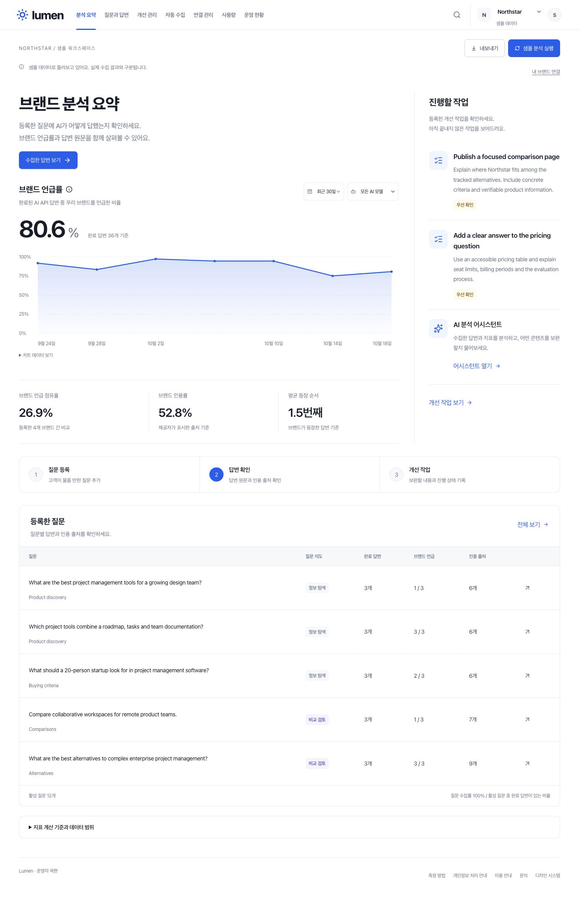

# Lumen

**AI가 브랜드를 어떻게 소개하는지 확인하고, 콘텐츠 개선 전후를 비교하세요.**

Lumen은 브랜드의 AI 답변과 검색 관측을 모아 관리하는 무료 워크스페이스입니다. Gemini API 답변을 수집하고, 직접 확인한 ChatGPT와 Perplexity 검색 결과를 기록하며, GA4 방문 자료와 함께 콘텐츠 개선 효과를 살펴볼 수 있습니다.

[서비스 이용하기](https://lumen-ai-visibility.khyun97.chatgpt.site/) · [시작 가이드](https://lumen-ai-visibility.khyun97.chatgpt.site/guides/free-ai-brand-tracking) · [측정 방법](https://lumen-ai-visibility.khyun97.chatgpt.site/methodology)



위 화면은 기능을 살펴보기 위한 합성 샘플이며 실제 브랜드의 성과를 나타내지 않습니다.

## 이런 일을 할 수 있습니다

- **브랜드와 질문 관리:** 내 브랜드, 경쟁 브랜드와 고객이 물어볼 질문을 등록합니다.
- **AI 답변 수집:** Gemini API 답변에서 브랜드 언급과 등장 순서를 확인합니다. 매일 또는 매주 같은 질문을 수집하고 실행 결과를 확인할 수 있습니다.
- **실제 검색 근거 기록:** ChatGPT와 Perplexity에서 직접 확인한 질문, 답변, 원래 인용과 검색 조건을 저장합니다. 여러 관측을 JSON으로 가져올 수도 있습니다.
- **콘텐츠 개선 전후 비교:** 개선 대상과 비교 대상, 질문과 기간을 먼저 정하고 같은 조건의 관측을 비교합니다. 실제 배포 시각과 변경한 페이지도 남깁니다.
- **GA4 기준 자료 연결:** 읽기 전용으로 연결한 속성에서 사이트 방문, AI 추천 세션과 페이지 조회를 가져옵니다.
- **개선 작업 관리:** 답변을 바탕으로 콘텐츠와 리포트 초안을 만들고, 할 일을 관리하며, 필요한 기록을 내보냅니다.

## 세 가지 자료를 구분해서 봅니다

| 자료 | 확인할 수 있는 내용 | 해석 범위 |
| --- | --- | --- |
| Gemini API 답변 | 수집한 답변의 브랜드 언급과 설명, 경쟁 브랜드 등장 | 무료 수집은 웹 검색을 사용하지 않는 일반 응답입니다. 실제 AI 검색 화면의 노출을 측정한 결과가 아닙니다. |
| 실제 AI 검색 관측 | 사용자가 확인한 답변의 브랜드 언급과 원래 인용 | 기록한 질문과 검색 조건 안에서의 관측입니다. 모든 이용자의 검색 결과를 대표하지 않습니다. |
| GA4 기준 자료와 사업 집계 | 방문 자료, 별도로 입력한 전환과 매출 집계 | GA4 기준 자료 가져오기는 방문까지만 확인합니다. 수집하지 않은 전환, 주문과 매출은 미측정으로 남깁니다. |

브랜드 언급이 늘어도 방문이나 매출이 늘었다고 단정하지 않습니다. Lumen은 근거와 관측 조건을 남기고 비교하는 도구이며, 검색 순위 상승이나 매출 증가를 보장하지 않습니다. 계산 기준과 제외되는 자료는 [측정 방법](https://lumen-ai-visibility.khyun97.chatgpt.site/methodology)에서 확인할 수 있습니다.

## 시작하는 방법

1. [Lumen](https://lumen-ai-visibility.khyun97.chatgpt.site/)에서 ChatGPT 계정으로 로그인하고 브랜드 이름과 웹사이트를 등록합니다.
2. 고객이 브랜드나 제품을 찾을 때 사용할 질문을 추가합니다.
3. 이용 조건을 확인한 뒤 Gemini 답변을 수집합니다. 답변 원문과 브랜드 언급을 살펴보세요.
4. 실제 검색 노출을 확인하려면 검증 계획을 만들고 ChatGPT 또는 Perplexity에서 직접 확인한 검색 결과를 기록합니다.
5. 콘텐츠를 개선한 뒤 같은 질문과 조건으로 다시 관측합니다. 방문 자료가 필요하면 GA4를 연결하세요.

검색 결과와 API 답변을 같은 자료로 취급하지 않는 것이 중요합니다. ChatGPT와 Perplexity 검색은 해당 서비스에서 직접 확인하며, Lumen 서버가 두 서비스의 검색 화면을 자동으로 실행하지는 않습니다.

## 무료 이용 범위

현재 공개 서비스는 카드 등록 없이 이용하는 무료 베타입니다.

| AI 호출 기본 한도 | 하루 | 월 |
| --- | ---: | ---: |
| 계정별 | 10회 | 100회 |
| 서비스 전체 | 50회 | 500회 |

질문 하나를 모델 하나에 보내면 1회를 사용합니다. 질문 제안, 콘텐츠 생성과 AI 상담도 같은 한도를 쓰며, 수동 수집과 정기 수집의 사용량을 합산합니다. 공용 한도에 도달하면 개인 잔여량이 있어도 실행이 제한됩니다. 한도는 UTC 기준으로 초기화되며 운영 설정에 따라 낮아질 수 있습니다. 실제 잔여량은 사용량 화면을 확인하세요.

검색 관측 저장과 GA4 기준 자료 가져오기는 AI 호출 한도를 사용하지 않습니다. 외부 검색 서비스의 기능과 이용 한도는 각 서비스에 따릅니다. 무료 운영에서는 Gemini만 사용하며 OpenAI와 Perplexity의 유료 API는 실행하지 않습니다. Gemini를 사용할 수 없을 때 유료 모델로 자동 전환하지 않습니다.

대한민국에서 이용하는 만 18세 이상의 업무 사용자를 대상으로 합니다. 공개된 업무 정보만 입력하세요. 무료 Gemini의 입력과 응답은 Google의 제품 개선과 인적 검토에 사용될 수 있으므로 개인정보, 민감정보와 기밀정보는 입력하지 마세요.

[이용 안내](https://lumen-ai-visibility.khyun97.chatgpt.site/terms)와 [개인정보 처리 안내](https://lumen-ai-visibility.khyun97.chatgpt.site/privacy)를 함께 확인해 주세요.

## 기록을 관리하는 방식

워크스페이스 데이터는 로그인한 소유자만 접근할 수 있습니다. 샘플 화면의 합성 데이터는 실제 수집 데이터와 구분합니다. 검색 관측은 확인한 시각, 검색 조건과 근거를 함께 남기며, 잘못된 관측은 사유를 기록해 집계에서 제외합니다.

답변과 문서는 CSV 또는 Markdown으로 내보낼 수 있고, 운영 화면에서 워크스페이스 JSON 백업을 내려받을 수 있습니다. 백업에는 사용자 입력과 답변이 포함되므로 안전하게 보관해야 합니다. API 키와 Google 인증 토큰은 백업에 포함하지 않습니다.

## 기술 구성

React 19, TypeScript와 Vinext App Router로 구성한 웹 애플리케이션입니다. Cloudflare Workers에서 실행하고, D1과 Drizzle로 데이터를 관리합니다. 현재 배포는 Sites의 ChatGPT 인증을 사용합니다.

| 경로 | 역할 |
| --- | --- |
| `app/` | 공개 페이지, 대시보드와 API 경로 |
| `components/` | 화면과 공통 UI |
| `lib/` | 지표 계산, 제공자 연결, 수집기와 데이터 처리 |
| `drizzle/` | 데이터베이스 스키마 변경 |
| `tests/` | 지표, 접근 제어, 수집과 복구 검증 |

### 개발 및 검증

Node.js 22.21 이상을 권장합니다.

```sh
npm ci
npm run typecheck
npm test
npm run build
```

테스트는 가상 제공자 응답과 로컬 D1을 사용하며 실제 AI API를 호출하지 않습니다. 로컬 D1 테스트에는 localhost 소켓 실행 권한이 필요합니다. 서비스 실행에는 별도의 D1 바인딩, 인증 환경과 서버 측 연결 설정이 필요하며, 저장소를 복제하는 것만으로 운영 서비스의 데이터나 연결을 사용할 수는 없습니다.

API 키, OAuth 자격 증명, `.env` 파일과 사용자 백업은 저장소에 추가하지 마세요. 서버 연결과 배포 설정을 바꾸기 전에는 무료 호출 정책과 접근 제어를 확인하세요.

자세한 로컬 실행 방법은 [개발 안내](DEVELOPMENT.md), 포함된 외부 코드의 출처와 라이선스는 [제3자 고지](THIRD_PARTY_NOTICES.md)를 참고하세요.

---

Lumen의 기능과 이용 조건은 [서비스 소개](https://lumen-ai-visibility.khyun97.chatgpt.site/)와 [시작 가이드](https://lumen-ai-visibility.khyun97.chatgpt.site/guides/free-ai-brand-tracking)에서 확인할 수 있습니다.
